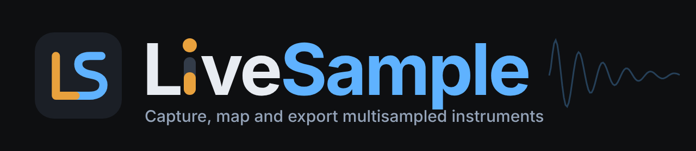

# LiveSample

Build professional multisampled instruments quickly — capture, analyse, map,
and export to SFZ, DecentSampler and Ableton.

Every visual value lives in `src/styles/tokens.css`; the brand (mark, colours,
type, and how it relates to LivePatch) is in [`brand/`](brand/README.md).

## Install

Download the latest build from the
[Releases page](https://github.com/williebob555-lab/LiveSample/releases/latest):

| Platform | File | Notes |
| --- | --- | --- |
| Windows | `LiveSample-<version>-setup.exe` | Per-user install, no admin prompt. |
| Linux (Fedora KDE etc.) | `LiveSample-<version>-x86_64.AppImage` | `chmod +x` it and run it. If it won't start, `sudo dnf install fuse-libs`. |

**Updates are built in.** The installed app checks quietly a few seconds after
launch; when something newer exists the **Updates** button in the top bar turns
into **Update to x.y.z**. Clicking it shows the release notes, downloads with
progress, and offers to restart into the new version (or installs the next time
you quit). It won't restart while the instrument has unsaved changes. Running
from source, the button explains that `git pull` is the update path.

## Releases

Pushing a version tag builds both installers in GitHub Actions
(`.github/workflows/release.yml`) and publishes them as a release, which is
the feed every installed copy updates from:

```bash
npm version patch      # or minor / major — bumps package.json and tags
git push --follow-tags
```

The app downloads updates anonymously, so **the releases must be publicly
readable**. A private repository's releases are not: the update check gets a
404 and the app reports "No release feed found". Either make this repository
public, or point `publish` in `electron-builder.yml` at a separate public
repository and give the workflow a token that can write to it.

To build locally without publishing: `npm run dist` (installer for the current
OS, in `release/`) or `npm run dist:dir` (unpacked, quicker to test).

## Run from source

Requirements: **Node 20+** (22 LTS recommended) and git. Electron is installed
by npm; nothing else is needed on Windows. On Linux see
[Fedora / Linux](#fedora--linux) for the few system packages first.

```bash
git clone https://github.com/williebob555-lab/LiveSample.git
cd LiveSample
npm install
npm start          # builds, then opens the desktop app
```

After the first build, `npm run electron` opens the app without rebuilding.

### Making an instrument

1. **Audio devices** — pick an engine and interface. *System (Web Audio)* works
   immediately; *Native driver* gives buffer control and is what you want for
   recording (see [Audio devices](#audio-devices)).
2. **Takes** — either import existing recordings (files, a folder, or one long
   take that gets split at the silences) or start a **capture session** and just
   play: the app names each note, waits for it to finish and moves on.
3. **Analyse and clean up** — pitch detection, trimming, level matching and
   loop finding run automatically; override anything per take.
4. **Map** — auto-map lays takes out across the keyboard; the coverage band
   shows anywhere that is missing or stretched too far. Fill gaps by repitch if
   you need a fully chromatic instrument.
5. **Refine** — envelope, filter, loops.
6. **Export** — SFZ, DecentSampler or a WAV folder with embedded root/loop
   data. Save the project (`.sinst` folder) to come back to it.

### Scripts

| Command | What it does |
| --- | --- |
| `npm start` | Type-check, build the UI and audio host, launch Electron. |
| `npm run electron` | Launch the last build without rebuilding. |
| `npm run dev` | Vite dev server with hot reload. Works in a plain browser too, minus native dialogs and native audio. Point Electron at it with `SAMPLER_DEV_URL=http://localhost:5210 npm run electron`. |
| `npm run typecheck` | `tsc --noEmit`. |
| `npm run selftest` | The DSP, model and exporter checks (below). No audio hardware needed. |
| `npm run test:capture` | Builds, launches the real app under Electron (xvfb is used when there is no display) and drives a whole capture session with synthetic tones in place of a microphone: onset and silence detection, advance, pitch analysis, a retake, save to `.sinst`, reopen. No audio hardware needed. Set by `SAMPLER_TEST_CAPTURE=1`, which is inert otherwise. |
| `npm run test:audio` | Boots the real audio host and plays a note through actual hardware. |
| `npm run dist` | Build the installer for this OS into `release/` (NSIS on Windows, AppImage on Linux). |
| `npm run release` | Same, and publish to GitHub Releases (CI does this on a tag). |
| `npm run brand` | Re-render `brand/png/` and the app icons from the brand SVGs. |
| `npm run install:desktop` | Linux, source checkout only: add a launcher entry (`-- --remove` to undo). The AppImage doesn't need it. |

`selftest` exercises the parts a screenshot cannot check — pitch detection
accuracy across the range, the WAV `smpl` chunk round trip, loop finding,
repitch accuracy, key-range arithmetic and the generated SFZ and DecentSampler
output, plus note-name parsing and capture/retake planning. 106 assertions,
all passing.

`test:audio` boots the real audio host, enumerates every driver API for the
current platform, opens a stream on the default device of the primary one
(WASAPI on Windows, PulseAudio on Linux), plays a note and checks that signal
came out. On Windows it additionally tries ASIO duplex.

## Fedora / Linux

Tested target: **Fedora KDE Plasma** (Wayland session, PipeWire). Other
current distributions running PipeWire or PulseAudio behave the same.

The simplest route is the AppImage from [Install](#install), which updates
itself. To run from source instead:

```bash
sudo dnf install nodejs npm git alsa-lib pulseaudio-libs
git clone https://github.com/williebob555-lab/LiveSample.git && cd LiveSample
npm install
npm start
npm run install:desktop   # optional: LiveSample in the Plasma launcher
```

`pulseaudio-libs` is only the client library — Fedora uses PipeWire, and its
`pipewire-pulseaudio` server (installed by default) is what the app talks to.
Both packages are normally already present on a desktop install.

**Which driver to pick.** In *Audio devices → Native driver*:

| API | Use it when |
| --- | --- |
| **PulseAudio** (default) | Almost always. Goes through PipeWire, shares the interface with everything else, honours the requested buffer size as a latency target. Your USB interface shows up here by its PipeWire name. |
| **ALSA** | You want the raw hardware. `hw:` devices are exclusive and PipeWire normally holds them, so opening one fails while the desktop is using it — pick the `pipewire` or `default` ALSA device to share instead. |
| **JACK** | Listed but unavailable: audify's prebuilt Linux binary is compiled without JACK. Under PipeWire nothing is lost — PulseAudio reaches the same devices. |

For lower latency, lower PipeWire's quantum (e.g. `pw-metadata -n settings 0
clock.force-quantum 128`) or set it permanently in
`~/.config/pipewire/pipewire.conf.d/`. The latency shown in the dialog is what
the server actually granted, not what was asked for. Pick the interface's sample
rate in KDE's audio settings (or `clock.force-rate`) to avoid resampling.

**Desktop integration.** On Linux the app runs natively on Wayland
(`ozone-platform-hint=auto`, falling back to X11 without a compositor), so it
stays sharp under KDE's fractional scaling. `npm run install:desktop` writes
`~/.local/share/applications/livesample.desktop`, pointing at this checkout —
after `git pull && npm run build` the launcher runs the new version.

**Troubleshooting.**

- *PulseAudio shows no devices* — the session's sound server is not running:
  `systemctl --user status pipewire-pulse`.
- *`test:audio` fails with "Connection refused"* — same cause; it needs a
  running desktop session, not an SSH shell or container.
- *The AppImage does nothing when launched* — it needs FUSE 2:
  `sudo dnf install fuse-libs`, or run it with `--appimage-extract-and-run`.
- *Electron exits with a sandbox error* (only with unusual kernel settings):
  run `npx electron --no-sandbox .`.

## Audio devices

Two backends behind one facade (`src/audio/output.ts`), both driving the same
selection logic so switching changes latency and driver, never which sample you
hear.

| Backend | What it gets you |
| --- | --- |
| **System (Web Audio)** | Zero setup, works in a browser. Device choice via `enumerateDevices` / `setSinkId`. Shared-mode only, so no ASIO and no buffer control. |
| **Native (RtAudio)** | Windows: WASAPI, DirectSound and **ASIO**. Linux: PulseAudio (PipeWire) and ALSA. Real sample-rate and buffer-size control, channel offsets, and duplex. |

Native audio runs in an Electron `utilityProcess` (`src/audio/host.ts`) with its
own voice renderer (`src/audio/render.ts`). Feeding an output queue on the main
thread, alongside window management and GC, is how you get dropouts.

The API list is per platform (`platformApis` in `src/audio/protocol.ts`), and
a saved configuration naming another platform's API falls back to the default.

Verified on Windows: WASAPI at 48 kHz / 512 frames (≈10.7 ms), and ASIO
duplex on a Yamaha Steinberg USB driver at 48 kHz / 256 frames (21.1 ms).

Five things here cost real debugging time and are worth not re-learning:

- **Electron must be 35+.** audify's prebuilt binary is N-API v10; Electron 33
  ships Node 20, which only provides N-API 9, and loading it *hard-crashes* the
  process with no catchable error. Node 24 has N-API 10, so it works under plain
  `node` and fails only under Electron.
- **Native modules do not load in a `utilityProcess` on old Electron** for the
  same reason. They do on 37.
- **audify's `bindings` lookup is wrong under Electron** — it searches from the
  app root, not the package, so `audify.node` is never found.
  `src/audio/audify-native.ts` resolves it from `audify/package.json` instead.
- **RtAudio device ids are per-instance, not global.** Every API's first device
  comes back as id 129. Enumerating through a throwaway instance and then
  streaming through a different one can open the wrong device — and a discarded
  ASIO probe keeps the driver open until GC, so the next open fails with
  "Another RtAudio ASIO stream is open". The host keeps one instance per API.
- **RtAudio falls back silently.** Ask for an API that is not compiled in or
  not running (ASIO with no driver, JACK on the Linux prebuilt) and you get a
  working instance of a *different* API. The host compares the reported name
  and marks the request unavailable rather than listing the fallback's devices
  under the wrong label.

ASIO drivers are exclusive: if a DAW, a browser tab, or system audio is using
the interface, opening will fail. The host retries once, verifies the stream is
still alive 250 ms after opening (an exclusive driver can accept the open and
tear it down immediately), and reports that plainly rather than showing a
running stream that is silently dead.

Installed ASIO drivers that do not respond are listed separately as "installed,
not responding" — read from `HKLM\SOFTWARE\ASIO` — so an unplugged interface is
distinguishable from one that was never installed.

## Your work is safe

- **Undo / redo** (Ctrl+Z, Ctrl+Shift+Z or Ctrl+Y, and the top-bar buttons)
  covers every edit, including audio processing: each step keeps the
  instrument plus references to the sample buffers, so undoing a Clean up,
  Denoise or retake brings the previous sound back, not just its settings.
  Processing never edits a buffer in place, which is what makes holding
  references safe and free. Rapid edits within 500 ms (a drag, typing) are one
  step; history holds 100 steps and resets on open.
- **Autosave.** Every minute while there are unsaved changes, a recovery copy
  goes to `<userData>/recovery/`. If LiveSample didn't close cleanly, the next
  launch offers to restore it. A clean save, quit or "Don't save" clears it.
- **Open Recent** in the top bar and on the welcome screen.

## MIDI

**MIDI…** in the bottom bar picks the input (all, or one port) and channel.
Any MIDI keyboard plays the instrument through the same audition path as the
on-screen keys, sustain pedal included.

**Unattended capture.** In the capture dialog, *Play each note over MIDI*
turns a session into a hands-off run for hardware synths: for each step the app
sends the note to the chosen MIDI output, records it, sends note-off after the
note length, waits for the release tail, and moves on. A step whose note never
arrives (muted or mis-routed synth) is skipped and counted rather than hanging
the run. All Notes Off is sent on stop.

## Articulations, mics and denoise

- **Articulations** (Map stage) — add, rename, reorder and delete; select by
  keyswitch, CC range, velocity range or always. Audition any one. SFZ sets
  `sw_default` so the default articulation plays before a keyswitch is pressed.
- **Mics** (Map stage) — a level and mute per mic position. Zones from every
  mic of the same note play together, mixed by those levels, in both engines
  and in SFZ / DecentSampler export.
- **Denoise** (Takes stage) — spectral gating with the noise profile learned
  from the quietest part of the take. Length and timing are preserved exactly,
  so zones and loops stay valid.

## The idea

The hard part of sampling is not DSP, it is labour and interruption. Recording
36 notes by hand means 36 cycles of play, stop, name and trim, and the moment
you were trying to capture is gone by note nine.

So the app runs the session and you just play. **Session mode** shows one
enormous note name, listens, detects when the note has finished, and advances on
its own — no mouse, readable from across the room. Everything else (pitch
detection, trimming, level matching, loop finding, mapping) happens afterwards,
automatically, with manual override.

Capture records through whichever device is selected, including ASIO.

Capture settings live on the instrument (`instrument.capture`) rather than in
the dialog, so they survive cancelling it, finishing a session, and saving the
project. A plan references articulation and mic ids, so it is validated against
the instrument on use — one that outlived an edit to either falls back rather
than capturing into a dangling id, which would produce takes that never map.

### Re-recording

A whole session to fix one bad note is not a reasonable ask. Select takes and
**Re-record** runs a session over just those slots, walking up the keyboard in
pitch order.

Retakes replace audio *in place*: the new recording takes over the existing
sample's id, so every zone already pointing at that take keeps working. The map
survives; only the audio changes. Slots are matched on note, velocity layer,
round robin, articulation and mic — with the caveat that mic only counts as a
dimension when the instrument actually has more than one, otherwise an imported
take carrying no mic id would never match its own retake step and the session
would silently append a duplicate instead of replacing.

### Reference pitches

Optionally the session plays the target note before arming. A sine is a poor
reference: with no harmonics the ear has nothing to anchor the octave to, and at
the top and bottom of the range — exactly where matching pitch is hardest — it
becomes genuinely ambiguous.

So there are two sources. **Repitch a take already recorded** takes the nearest
captured note and shifts it to the target, which is the easiest thing to tune
against because it is the instrument you are actually playing. **Built-in
instrument** offers piano, organ, pluck, reed, triangle and sine — additive
stacks synthesised at any pitch (`src/audio/reftones.ts`), covering the first
note of a session before there is anything to repitch.

The cue comes out of the speakers, so the onset detector stays disarmed until it
has finished — otherwise the session records its own reference.

## What makes an instrument sound professional

Almost none of it is audio quality. In rough order of impact:

- **Consistency across zones.** Neighbouring notes at different levels or
  distances read as fake immediately. `cleanupSamples` matches levels across the
  whole set, not per file.
- **Enough zones that repitching does not show.** Stretch one sample five
  semitones and it sounds like a cartoon.
- **Round robins.** The same sample on repeated notes — the machine-gun effect —
  is the most obvious tell. The engine defaults to random-no-repeat, because
  plain random repeats often enough to reintroduce it.
- **Velocity layers that crossfade** rather than stepping.
- **Release samples.** The sound of a note *stopping* is most of what
  "realistic" means.
- **Loops that do not breathe.**

## Closing the window

Worth knowing, because it cost real time: **a `beforeunload` handler that
calls `preventDefault()` does not prompt in Electron.** It silently refuses to
close, and once the project is dirty the app becomes unquittable.

The unsaved check therefore lives in the main process, which owns the window and
can show a real dialog. The renderer only reports its dirty state and does what
it is told. Save is asked of the renderer (it owns the audio) but never waited
on indefinitely — a wedged save closes anyway after 20 seconds, and `will-quit`
force-exits if a native driver refuses to release. Nothing should be able to
trap you in an app you cannot close.

`app.dirty` is a property rather than a field so the main process hears about
every change; some edits (capture settings among them) set it without triggering
a re-render, and a missed signal means closing without the prompt.

## Notes are notes

Anything that means a pitch is shown and edited as a pitch — `C3`, not `48`. A
MIDI number is an implementation detail, and making the musician translate is a
small tax paid on every single interaction.

`src/ui/notes.ts` has the two primitives:

- **NoteField** — type a note name (`C3`, `f#4`, `Bb2`, `A-1`, or a bare MIDI
  number if you paste one). Arrow keys step a semitone, Shift+arrow an octave,
  and the wheel scrolls. Unparseable input is rejected and the previous value
  restored, rather than silently writing a wrong pitch.
- **NoteRange** — two handles on one track for a low/high span, over a
  keyboard-shaped scale with the black keys drawn as darker bands and C
  positions marked, so a position reads as a place on an instrument rather than
  a percentage. Clicking grabs whichever handle is nearer; they cannot cross.

Used for the capture range, zone key ranges, root keys and capture targets.
Velocity stays numeric, because velocity genuinely is a number.

## The four stages

Each stage owns a distinct centre panel. Map and Refine used to render the same
zone map, which made Refine look like it did nothing.

| Stage | Centre |
| --- | --- |
| **Takes** | The waveform, with analysis and cleanup actions. |
| **Map** | The zone grid, plus a **coverage band** showing per key whether anything plays there and how far the nearest sample is stretched to do it. |
| **Refine** | A draggable **ADSR envelope**, the **filter response curve** computed from the same biquad the engines use, and a **loop overview** listing every zone's loop state. |
| **Export** | Targets, capability warnings, and what gets written. |

The coverage band deliberately measures stretch the same way the status bar's
`maxStretch` does — only within the range that was actually sampled. The
outermost zones are widened to keys 0 and 127 so the instrument answers across
the whole keyboard, and counting those tails as defects would report ~39
semitones for a perfectly good map. They are drawn as a neutral wash instead,
so they read as intentional rather than broken.

## Model

```
Instrument
  └─ Articulation[]     switchable variants (sustain / staccato / pizz)
       └─ Group[]       shared playback behaviour, round-robin rules, envelope
            └─ Zone[]   one sample placed in key × velocity space
```

Samples live in a flat pool and are referenced by id, so one take can serve
several zones. The model is the **union** of what SFZ, DecentSampler and Ableton
can express, not the intersection — exporters declare what they drop, and the
app warns before writing rather than leaving you to find out in the DAW.

## Repitching to fill gaps

Two different things share one name:

- **Playback repitch** — what every sampler does. Free, and the only question is
  how far you can push it. Roughly 2–3 semitones for voice and solo winds, 4–6
  for piano and plucked strings, an octave for pads.
- **Generative repitch** (`fillGapsByRepitch`) — renders *new sample files* at
  the missing pitches, so the shipped instrument is chromatic with no stretching
  at all. Uses formant-preserving pitch shift (STFT with cepstral envelope
  correction), because naive resampling is exactly the chipmunk artefact you
  were trying to avoid. Turns a 12-note session into a 60-note instrument.

Formant correction is right for voice and wind and too much for struck and
plucked material, so its strength is adjustable.

## Export

Your `.sinst` folder is the source of truth; everything else is a projection.

| Target | Carries |
| --- | --- |
| **SFZ** | Key ranges, velocity layers and crossfades, round robins, articulations, release triggers, choke groups, loops, filters, envelopes |
| **DecentSampler** | The above minus filters, plus a skinned UI |
| **WAV folder** | Cleaned audio with root note, tuning and loop points written into each file's `smpl` chunk |

**SFZ is the plugin path.** [sfizz](https://sfz.tools/sfizz/) is a free VST3 SFZ
player, so a good `.sfz` is a playable instrument in any DAW without writing a
line of plugin code. Writing a JUCE VST3 duplicates something free and mature;
revisit only if SFZ genuinely cannot express something.

**Ableton** reads the `smpl` chunk — drag the `samples/` folder onto a Sampler
instance's zone view and Live lays the map out from the files themselves.
Native `.adg` writing is not implemented: `.adv`/`.adg` are gzipped XML
(confirmed — `<MultiSampler>` → `<MultiSampleMap>` → `<SampleParts>`), but
generating `MultiSamplePart` entries needs a populated preset to match the
schema against, and guessing produces files Live silently refuses. Save a
Sampler preset with one sample loaded and that exporter becomes straightforward.

Note Sampler is a Suite device. On Standard the target is an Instrument Rack
with one Simpler per key/velocity zone, which is also the more portable option.

## Project format

A folder, not a zip — these run to hundreds of megabytes and repacking on every
save would make saving something you avoid.

```
MyPiano.sinst/
  instrument.json
  samples/*.wav
```

## Layout

```
src/
  core/      types.ts (the model) · automap · pipeline · project · native
             history (undo) · recovery (autosave) · midi · articulations · capture
  dsp/       wav (incl. smpl) · pitch (YIN) · analyze · loop · resample · fft · denoise
  export/    context (filenames) · sfz · decentsampler · index (targets, warnings)
  audio/     store (decoded audio) · engine (audition) · output · host · render · protocol · midi
  ui/        studio (layout, coordinator) · project-actions (open/save/import)
             stages/ takes · map · refine · export — one module per stage
             session · zonemap · keyboard · waveform · coverage · curves · notes
             articulations · mixer · denoise · midi-settings · audio-settings
             updates · brand · primitives · dom
  styles/    tokens.css · app.css
electron/    main.cjs (incl. updater) · preload.cjs
.github/     workflows/release.yml
linux/       livesample.desktop.in
brand/       mark, wordmark, lockups, banners (SVG source) · png/ (generated)
scripts/     selftest.ts · test-capture.cjs · test-host.cjs · make-brand.cjs
             build-host.mjs · install-linux.sh
```

The audition engine deliberately uses the same selection rules the exporters
describe — articulation → group → key/velocity zone → round-robin slot. An
audition that flatters the instrument by using different rules than the exported
file is worse than no audition at all.

`src/core` and `src/dsp` have no DOM and no Electron dependency, which is what
makes the self-test possible and keeps the door open to reusing them elsewhere.

## Notes

- The UI is a **design system, not a theme system** — one look, fixed, with
  nothing exposed to the user. Making all ~45 visual parameters adjustable in an
  earlier project meant nothing had a designed default.
- Inter is bundled, so the typography is the same on every OS rather than
  Segoe UI on Windows and Noto Sans on Fedora.
- Numbers use tabular figures everywhere. Values that jitter horizontally as
  they change are the loudest amateur tell in audio software.

## Status

Working: import (files, folders, long-take splitting), analysis, cleanup,
denoising and level matching, auto-mapping, loop finding, gap filling by
repitch, the audition engine, zone editing, articulation editing, mic mixing,
capture sessions with reference pitches, MIDI input and MIDI-driven unattended
capture, undo/redo, autosave recovery, in-app updates, audio device selection across WASAPI / ASIO / DirectSound on Windows and PulseAudio
(PipeWire) / ALSA on Linux, and SFZ / DecentSampler / WAV
export.

Not yet: native Ableton `.adg` (needs one saved Sampler preset to match the
schema against), DecentSampler UI designer, pitch bend in the audition engines,
and mic delay in the native renderer (the web engine and SFZ honour it).

Covered by `npm run test:capture`, with synthetic input: the capture session
logic (onset detection, silence ending a take, auto-advance, trimming, pitch
analysis, retake replacing a take in place and keeping its zone) and `.sinst`
save/load round-tripping, in the real built app. The test feeds blocks through
the facade's capture sink (the one the native host feeds), bypassing both driver
paths, and does not use the
native dialogs.

Untested against real hardware: the microphone driver path itself (Web Audio
`getUserMedia` and the RtAudio capture stream, so real gain, latency and room
noise); the Linux native path on a live PipeWire session (enumeration and the
fallback reporting are verified; no stream has been opened on real Linux audio
hardware yet — `npm run test:audio` on a Fedora desktop is the check); MIDI
with real devices (message parsing and the unattended-capture timing are unit
tested; Web MIDI access, hot-plug and a synth-driven session are not); and the
native open/save dialogs.
